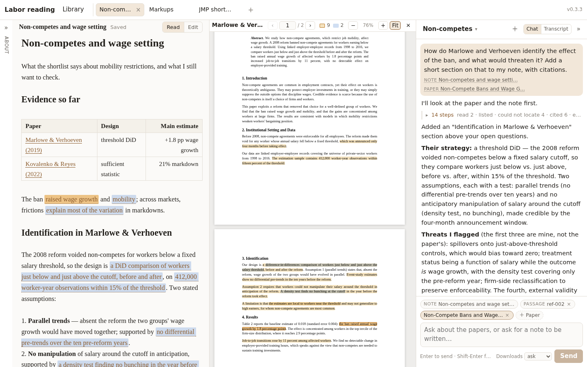
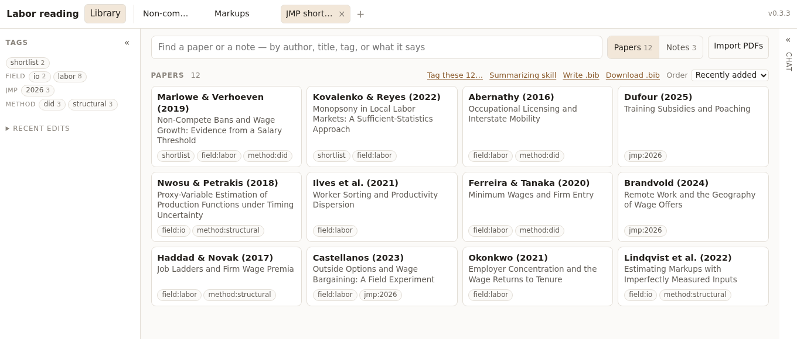

# Litmark

A local research application: import papers, read short cited summaries, write
Markdown notes, inspect the cited PDF passages, and chat with a coding agent
that can search the project and edit its files.

**Import papers → ask questions → write a sourced note → inspect the evidence → refine the note.**





<sub>The papers in these screenshots are invented.</sub>

## What it does

- **A library for your papers.** Drop in PDFs and get a grid you can search,
  tag and sort, each paper named the way it is cited —
  [*Olley & Pakes (1996)*](#papers-by-author-and-year).
- **Summaries with their evidence, written your way.** Every paper gets a short
  summary whose claims link to the passage they rest on. A
  [summarizing skill](#the-summarizing-skill) learns from what you tell it how
  you want them written.
- **Notes you can check.** Notes are Markdown, with tables and math. A
  [citation](#citations) opens the paper at the highlighted passage, and a
  highlight in the paper leads back to the sentence that cites it.
- **A pen for the margins.** [Draw on a paper's pages](#drawing-on-a-paper)
  with a pen and a highlighter — a stylus on a tablet, a mouse at a desk — and
  download a copy with the ink on it.
- **An agent that reads the papers.** Ask a question and it searches, reads the
  pages it needs, quotes them, and edits your notes — every step shown, every
  edit listed with an undo.
- **[Sessions](#sessions).** Several lines of work side by side, each with its
  own conversation and its own place: the note, the paper, the page.
- **A memory for other Claude sessions, and a command line.** A session
  elsewhere can recall what the library holds and add to it
  [over MCP](#a-memory-for-other-sessions-mcp); so can you,
  [from a terminal](#from-a-terminal).
- **Plain files, kept in step.** Everything is Markdown and PDFs in a
  directory you can move. [Text syncs through git and papers through
  S3](#sync-text-in-git-papers-in-storage), with a BibTeX export.
- **Runs on your machine or [in a container](#running-it-in-a-container)**,
  behind a sign-in page when it is reachable by more than you.

Everything you write stays as ordinary files in a movable project directory:
`notes/*.md`, `documents/<id>/original.pdf`, `references.json`. The application
is a convenient view onto those files, not their owner.

## Install

```bash
python -m pip install litmark          # core reader and editor
python -m pip install 'litmark[claude]'  # plus the agent adapter
```

Requires Python 3.11+. Tested on macOS and Linux. The published wheel contains
the compiled browser assets — **you do not need Node, npm, or a second web
server to run this application.**

With `pipx` or `uv`:

```bash
pipx install litmark
uv tool install litmark
```

## Use

```bash
litmark init ./my-research
litmark serve ./my-research --open
```

`serve` binds to `127.0.0.1`, prints the local URL, and serves exactly one
project per process. Reopening an existing project needs no initialization, and
`init` never overwrites existing material.

### Reaching it through a proxy or port-forward

By default the server binds to loopback *and* rejects any `Host` header that is
not a loopback name. That second check is what stops a malicious page from
using DNS rebinding to talk to your local server — but behind a reverse proxy
or a port-forward the header carries the proxy's hostname, so the check would
reject every real request. Widen it explicitly:

```bash
# Bind beyond loopback; any Host header is then accepted.
litmark serve ./my-research --host 0.0.0.0

# Or name the proxy's hostname and keep the check strict.
litmark serve ./my-research --host 0.0.0.0 --allow-host papers.internal
```

The per-process session credential embedded in the served page remains the
access control in both cases. On an untrusted network prefer an SSH tunnel,
which keeps the default loopback binding intact:

```bash
ssh -N -L 8765:127.0.0.1:8765 you@the-machine
```

Check your environment at any time:

```bash
litmark doctor ./my-research
```

`doctor` reports on the workspace, the optional agent dependency, the runtime
it needs, and whether authentication is configured — without printing secrets.

## Agent configuration

The agent backend is the [Claude Agent SDK for
Python](https://code.claude.com/docs/en/agent-sdk/python), behind a
provider-neutral adapter. Provider credentials and billing are separate from
installing this application; a consumer chat subscription does not by itself
grant SDK access.

The reader and editor work with no agent account at all. Import and text
extraction still run; automatic summaries wait until an agent is configured,
and the interface says so plainly.

The agent sees this project and nothing else. It is given the project's own
tools — search, read pages, resolve a quotation, version-checked edits — and
none of what you have set up for your own Claude Code sessions: no personal MCP
servers, plugins, hooks, skills, or memory. A PDF is untrusted text, so nothing
beyond the project is within the agent's reach; it also keeps the start of
every conversation small.

Optional settings in `project.toml`:

```toml
[agent]
model = "claude-opus-5"   # what answers by default; the adapter's own choice when unset
effort = "medium"         # reasoning effort by default, when the model takes one
max_parallel_runs = 3     # conversations that may be working at once
auto_summary = true       # summarize a paper when it is imported
downloads = "ask"         # may the agent fetch a paper from the web: always, ask, never
```

`model` and `effort` are where a session starts. Each session can choose its
own from the button beside the message box — `opus`, `sonnet`, `haiku`, or any
model named by its ID, and an effort from `low` to `max` — and keeps that
choice from its next message on. Summaries always run on the project's
settings.

## Sessions

Several lines of work go on at once — a paper being read for one thing, a note
being written for another — and each has its own conversation with the agent.
A **session** is that conversation together with what was on screen for it:
the note or summary that was open, the paper beside it and the page it was at,
the papers attached to the next question, whether the library was up.

Sessions sit in a row in the top bar. Click one and you are back in that work,
not only in its transcript; the others carry on meanwhile, and a dot on a tab
says the agent is working there, or has answered since you looked. **+** starts
a new one, with nothing open. Until something has been asked in it, a session
goes by what is open in it.

- **Each has an address** (`/s/…`), so one can be opened in another browser
  window and kept there — Ctrl- or middle-click its tab — and Back and Forward
  go between the sessions you were in. A window is titled for its session.
- **The view is kept on the server**, a moment after it settles, so a session
  is the same from another machine, and after a restart.
- **×** puts a session away. Nothing is deleted: it is still in the chat's own
  list, and going to it there brings it back to the row. Deleting a
  conversation is done from that list, as before.

Sessions share one library: the same papers, notes and summarizing skill.

## Conversations

The chat drawer holds as many conversations as you like, and they do not wait
on each other: ask a long question in one, start another, and both work. The
header names the conversation on screen; its menu lists the rest — most recent
first, with a dot on any that is working or has answered since you looked —
and renames, exports, or deletes the current one. A conversation is named for
the first thing asked in it.

Each conversation keeps its own thread with the agent, so coming back to one
next week carries on where it stopped. If the agent's saved session can no
longer be reopened (the project moved, or another machine opened it), the next
reply starts a new one from the transcript kept in the project, and says so.

A turn shows the agent's prose in full and one line per step in plain terms —
*read Mobility Restrictions, pp. 3–5*, *cited p. 12*, *edited note “Findings”*
— and each line opens what it names: the paper at that page, the highlighted
passage, the note. Edits are listed under the turn with an undo. The
**Transcript** tab shows the same turns verbatim, every tool call with its
arguments. Both views are drawn from the run's recorded events, so what a turn
did is still there after a reload.

Summaries of imported papers run as background work in a conversation of their
own, listed at the bottom of the menu, and never in the middle of yours.

### Saying it instead

Beside **Send**, and beside **Ask** in the box that opens by a selected
passage, is a microphone. Press it and speak: the words go in at the caret as
they are heard, provisional ones first and the settled ones in their place.
Press it again, or **Esc**, to stop. Sending stops it too, and what was said so
far is what is sent. It only types: what you dictate is yours to correct
before it goes anywhere.

This is the browser's own speech recognition, not something litmark runs,
which decides three things. A browser without it (Firefox, at the time of
writing) shows no microphone. It decides where your voice goes: Chrome and Edge
send the audio to their vendor's servers to be transcribed, and Safari uses
Apple's. And browsers lend the microphone only to a page served over HTTPS or
from `localhost`, so litmark reached at a bare `http://` address on another
machine, a Tailscale IP for instance, gets a refusal that says so. A TLS proxy
in front (`tailscale serve` will do) fixes that. Nothing is captured before the
button is pressed or after it is released, and the button is red for as long
as it is listening.

## A memory for other sessions (MCP)

A project is also somewhere other Claude sessions can remember things. A
session in a terminal on another machine, talking about a paper, can ask this
project what it already holds, set down what it learns, and send in the paper
itself — and what it writes shows up here, beside the PDF, cited and editable
like anything else.

It is off until the server is started with an access token, taken from the
environment so it is never in a file of the project. It needs the `mcp` extra
(`pip install 'litmark[mcp]'`; the container image has it):

```bash
export LITMARK_MCP_TOKEN="$(openssl rand -hex 32)"
litmark serve ./my-research --host <tailscale-address> --allow-host <its-name>
```

The server then answers MCP at `/mcp` (streamable HTTP), asking for the token
as a bearer credential. To connect Claude Code:

```bash
claude mcp add --transport http litmark http://<its-name>:8765/mcp \
  --header "Authorization: Bearer $LITMARK_MCP_TOKEN"
```

Add `--header "X-Litmark-Client: laptop"` to choose the name its edits are
recorded under; otherwise it is what the client calls itself (`claude-code`).

A session gets the tools the agent inside has, and two ways of using them as a
memory:

- **Learning from earlier work.** `recall` searches notes, summaries and the
  papers' text in one call; `read_note`, `read_summary` and `read_pages` then
  give what it points to in full.
- **Setting something down.** `append_note` adds to the end of a note without
  reading or disturbing the rest, creating the note if need be. `write_note`
  and `patch_note` revise, under the same version check as every other edit.
  `resolve_source` turns a quotation into a citation you can click.
- **Summarizing your way.** `read_skill` gives the summarizing skill — how you
  want papers summarized, as learned from you — and a session is told to read
  it before `write_summary`. `write_skill` records a preference you state to
  that session, so that it holds here too. See
  [The summarizing skill](#the-summarizing-skill).
- **Adding a paper.** A tool call carries JSON, not files, so `add_paper`
  answers with a one-time upload address and the session sends the PDF to it
  (`curl -T paper.pdf <address>`). The address expires after fifteen minutes,
  works once, and needs no other credential. The reply names the new paper once
  its text is extracted. A session with no way to make an HTTP request cannot
  add papers; import those in the browser.

**What a session elsewhere did is on the record.** Each of its edits, imports
and tag changes is listed under *Recent edits* with the client's name, set
apart from yours and the built-in agent's, and edits to notes and summaries can
be undone there. The git commit that carries such an edit says so in its
message (`Edited over MCP by claude-code: note reading-log`), so the
attribution travels with the project. A session cannot choose the name it is
recorded under beyond that header, and cannot overwrite an edit it has not
read: a stale write is refused, as it is for everyone.

**The token is the whole of the protection**, and it is sent in the clear over
plain HTTP. Keep the server on a private network (Tailscale, WireGuard) or
behind TLS. Whoever holds the token can read every paper and note and rewrite
them. With `LITMARK_PASSWORD` also set, the browser is still asked for the
password; `/mcp` asks for the token instead.

## From a terminal

The same memory, without a session in between. `litmark serve` runs where the
project lives; the commands below run wherever `litmark` is installed and ask
that server. They need its address and its token — the one in
`LITMARK_MCP_TOKEN` — and no project directory of their own:

```bash
export LITMARK_URL=http://<its-name>:8765
export LITMARK_MCP_TOKEN=…        # the token the server was started with

litmark recall minimum wage employment
litmark add ~/Downloads/card-krueger.pdf --tag field:labor
litmark pages doc-007 3-5
litmark cite doc-007 4 "no indication that the rise in the minimum wage reduced employment"
litmark append reading-log "No employment effect [Card and Krueger, p. 4](source:ref-031)."
litmark edit reading-log          # in $EDITOR
```

| | |
|---|---|
| `recall WORDS…` | notes, summaries and passages on a subject, in one go |
| `papers`, `search WORDS…` | the papers with their IDs and tags; passages of their text (`--tag`, `--in DOC`) |
| `pages DOC 3 4-6` | a paper's extracted text, page by page |
| `summary DOC` | a paper's summary |
| `skill` | the summarizing skill: how papers are to be summarized |
| `notes`, `note NOTE` | the notes; one of them |
| `append NOTE [TEXT]` | add to the end of a note, from the arguments or standard input |
| `write NOTE`, `edit NOTE` | replace a note from standard input or `--file`; or open it in `$EDITOR` |
| `delete NOTE` | delete a note; it can be brought back from *Recent edits* |
| `add PDF…` | send papers in (`--tag`, `--no-summary`) and wait for their text |
| `details DOC --author NAME… --year Y --title T` | say what a paper is, where the PDF got it wrong |
| `tag DOC… --add T --remove T` | change tags |
| `cite DOC PAGE "QUOTE"` | register a quotation, and print the link that cites it |
| `tools`, `call TOOL key=value…` | everything the server can be asked, and a way to ask for any of it |

Each command is one call to the tools a session gets over MCP, so the rules are
the same ones. `write` replaces an existing note only with the revision you
read (`note` reports it, `--revision` takes it; `edit` does both for you, and
keeps what you typed if the save is refused). A link to a source must be to one
that `cite` registered.

**Output is for reading; `--json` gives the answer as it came.** `note` and
`summary` print the text alone on standard output, so `litmark note plan >
plan.md` is the note. A command that was refused says why and exits with 1.

**What a command writes is on the record** like any other edit from outside,
under the name `cli`. Run by a Claude Code session, a command is recorded as
`claude-code` — as it would be had the session connected over MCP — so what you
typed and what a session did stay apart. Set `LITMARK_CLIENT`, or pass `--as`,
to name a machine instead.

For a session that has a shell, this is also a way to use the project with
nothing connected beforehand: `litmark recall …` in a terminal is the same
question as the `recall` tool. The token is read from the environment only,
never from the command line, and is sent to whatever `LITMARK_URL` names — the
same care applies as for MCP.

## Tags

A tag is your own label for gathering papers: a field, a year's job market, a
candidate, a shortlist. Tags are free text — there is nothing to set up before
the first paper can be put in a pile. One written `group:value`
(`field:labor`, `jmp:2026`, `author:Card`) is shown under its group, which is
all the structure there is.

- **Filter.** Beside the library, every tag in use is a chip with a count.
  Click one to see only the papers carrying it; click several to narrow to
  papers carrying all of them. *untagged* lists the papers with none. A tag on
  a paper's card does the same.
- **Tag one paper** with **Tag** / **Edit tags** in the panel beside it when
  it is open, or **all the papers shown** with **Tag these N…** in the library
  — filter to *untagged* after a batch import, and one tag gathers the batch.
- **Import into a collection.** PDFs dropped in while a tag filter is on arrive
  already carrying those tags.
- **In chat**, type a tag in the paper picker and **Attach all** to hand the
  agent a whole collection. The agent sees every paper's tags, can list and
  search within a tag (*"which of the jmp:2026 papers use an event study?"*),
  and tags papers when you ask it to (*"tag each by field"*).

Typing a tag in a different case than one already in use takes the existing
spelling, so `Labor` and `labor` do not become two collections. Tags are stored
in each paper's `metadata.json`, so they travel with the project through git,
and they are written to `references.bib` as `keywords`.

## Sync: text in git, papers in storage

A project is two kinds of material, and each travels the way that suits it.

**Text goes through git, and Litmark does the committing.** Notes, summaries,
the reference registry, each paper's `metadata.json` and the ink drawn on it
are small files that merge well. Make the project a repository and Litmark commits what changed once
your edits have settled, brings in what the remote has, and publishes — on its
own, and when you press **Sync now**:

```bash
litmark init ./my-research --git-remote git@github.com:you/research.git
# or, for a project that already exists:
litmark sync ./my-research --git-remote git@github.com:you/research.git
```

Commit messages say what happened in the project's terms (*Add 2 papers;
update note findings*). The top bar shows where things stand. If the same
lines were changed here and elsewhere, nothing is overwritten: your copy stays
exactly as it was, your commits are published to a side branch so they exist
somewhere other than this disk, and you choose which version of the clashing
lines to keep — everything else from both sides is kept either way.

Litmark only ever acts on a repository whose top level *is* the project. A
project that merely sits inside some other repository is left alone.

**Papers go to a store, addressed by their hash.** A PDF is megabytes that
never change, which git handles badly. Name a bucket and the PDFs go there,
under the SHA-256 the project already records for each document:

```bash
litmark init ./my-research --git-remote … \
  --s3-bucket my-papers --s3-prefix research \
  --s3-endpoint https://<account>.r2.cloudflarestorage.com   # omit for AWS
```

```toml
# project.toml — travels with the project, so a clone already knows its bucket
[storage]
backend = "s3"            # or "directory", with `path = "/mnt/papers"`
bucket = "my-papers"
prefix = "research"
endpoint_url = "https://…"   # any S3-compatible service; unset for AWS
prefetch = false          # true fetches every PDF up front
```

Credentials are never in the project: S3 uses the standard chain
(`AWS_ACCESS_KEY_ID` and `AWS_SECRET_ACCESS_KEY` in the environment, a shared
credentials file, or the machine's role). Install the extra with
`pip install 'litmark[s3]'`.

On another machine, `litmark clone <remote> ./my-research` brings the text.
The extracted text of every paper is fetched as soon as the project opens, so
search and the agent work across the whole library at once; each PDF is
fetched the first time it is opened, and checked against its hash. With no
storage configured the PDFs simply stay in git.

`litmark sync [path]` does one round from a terminal; `--all-papers` fetches
every PDF, and `--keep mine|theirs` settles a conflict. `litmark doctor`
reports whether the store is reachable.

Conversations are not synced. They stay on the machine they were held on; the
notes and summaries they produced are files, and travel.

Run one copy at a time, or let each sync before working in the other: document
and reference IDs are handed out in sequence (`doc-004`, `ref-012`), so two
copies that both import papers before syncing will both claim the next number,
and git will report that as a conflict rather than merge it.

## Running it in a container

The image holds the server, the browser assets, the agent runtime and git;
nothing in it is precious, because text is in the remote and papers in the
bucket.

An image is published for every release, for amd64 and arm64:

```bash
docker pull ghcr.io/tlamadon/litmark:latest
```

Releases are versioned MAJOR.MINOR.PATCH, and each is published under tags of
decreasing precision, so a deployment chooses how much it wants to move:

| Tag | What it is |
| --- | --- |
| `1.2.3` | Exactly that release. Never moves. |
| `1.2` | The newest patch of 1.2. |
| `1` | The newest release of major version 1. |
| `latest` | The newest release. |
| `main`, `sha-<commit>` | Unreleased builds of `main`, for trying a change before it is tagged. |

To release, set `__version__` in `src/litmark/__init__.py` (the one place the
version is written), commit, and push a tag of `v` + that version:

```bash
git tag v1.2.3 && git push origin main v1.2.3
```

It is built by `.github/workflows/container.yml`, which runs the tests, then
starts the image and checks that it works (`docker/smoke-test.sh`) before
anything is pushed. To build it yourself instead: `docker build -t litmark .`

```bash
docker run -d --name litmark -p 127.0.0.1:8765:8765 -v litmark-data:/data \
  -e LITMARK_GIT_REMOTE=https://github.com/you/research.git \
  -e LITMARK_GIT_TOKEN=… \
  -e LITMARK_S3_BUCKET=my-papers -e AWS_ACCESS_KEY_ID=… -e AWS_SECRET_ACCESS_KEY=… \
  -e ANTHROPIC_API_KEY=… \
  -e LITMARK_PASSWORD=… \
  ghcr.io/tlamadon/litmark:latest
```

On first start it clones the remote; if the remote is empty it creates the
project there, with the bucket named in the environment written into
`project.toml` so the next clone needs no telling. `docker/compose.example.yaml`
is the same thing as a Compose file.

| Variable | Purpose |
| --- | --- |
| `LITMARK_GIT_REMOTE` | The project's git remote. Without it the text lives only in the volume. |
| `LITMARK_GIT_TOKEN` | A token for an `https` remote. Passed to git by environment, never written to disk. Or mount an SSH key. |
| `LITMARK_S3_BUCKET`, `_PREFIX`, `_ENDPOINT`, `_REGION` | Where papers go, when the project is first created. |
| `AWS_ACCESS_KEY_ID`, `AWS_SECRET_ACCESS_KEY` | Credentials for the bucket. |
| `ANTHROPIC_API_KEY` or `CLAUDE_CODE_OAUTH_TOKEN` | The agent's credential. The second is what `claude setup-token` issues, for using a subscription where no browser sign-in is possible. |
| `LITMARK_PASSWORD` | Asked for, at a sign-in page, before anything is served. |
| `LITMARK_MCP_TOKEN` | Opens `/mcp` to other sessions holding this token. Unset, it is not served. See [A memory for other sessions](#a-memory-for-other-sessions-mcp). |
| `LITMARK_UPDATE_CHECK` | `off` stops the server asking GitHub, a few times a day, whether a later release exists. The top bar shows the version running either way; with the check on, it marks when a later one is out. |

**Set a password, and put TLS in front.** Without `LITMARK_PASSWORD`, anyone
who can reach the port can read the project and run the agent on your account.
The password protects nothing in transit by itself: serve it through a
TLS-terminating proxy, or keep it on a private network (Tailscale, WireGuard).
The example publishes the port on loopback only for that reason. This is
access control for one person, not multi-user hosting.

**Signing in is a page with a form**, not the browser's own dialog, so a
password manager can fill it and offer to remember it: the field is marked as
the current password, and filed under the name `litmark`. A browser opening
any address is sent to `/login` and brought back to where it was going. Being
signed in is a cookie good for thirty days — out of reach of scripts, kept to
TLS where the page came over it — and it survives the server restarting, so a
redeploy does not sign you out; changing the password ends every session.
**Sign out**, in the top bar, ends it in that browser. A handful of wrong
passwords in a few minutes and the form stops answering for a while.

A script can still send the password as HTTP Basic (`curl -u any:$PASSWORD`).

## Project layout

| Path | Purpose |
| --- | --- |
| `project.toml` | Schema version and non-secret project settings. |
| `documents/<id>/original.pdf` | Original immutable PDF. |
| `documents/<id>/metadata.json` | Identity, hash, filename, title, page count, tags, status. |
| `documents/<id>/pages.json` | Per-page text, character geometry, offset mapping. |
| `documents/<id>/summary.md` | Editable, cited summary. |
| `documents/<id>/ink.json` | What was drawn on the paper's pages. Absent until something has been. |
| `notes/*.md` | User and agent notes. |
| `skills/summary.md` | How papers are summarized, as learned from you. Absent until something has been. |
| `references.json` | Versioned source registry. |
| `references.bib` | Generated BibTeX bibliography of the imported documents. |
| `.gitignore` | Written when the project is a repository: keeps `.research/`, extracted text, and stored PDFs out of git. |
| `.research/state.sqlite` | Conversations, events, jobs, run state, change log. |
| `.research/history/` | Previous file contents, for review and undo. |
| `.research/runs/` | Staged agent edits and run diagnostics. |

## The library, and what is open

The application opens on the **library**: every paper and every note as a grid
with the width of the page, which is what a hundred papers need. Type to
narrow it — by author, year, title, tag or file name, at once — and the text
of the papers and notes is searched as well, a moment later, under *In the
text*. Order the papers by when they were added, by author, by year or by
title. **Papers** and **Notes** are two tabs; a search looks through both.
Drop PDFs anywhere on it to import them.

A click on a paper opens its summary with the PDF beside it; a click on a note
opens the note. **Library**, in the top bar, lays the grid back over whatever
is open — and takes it away again, with what you were reading where you left
it.

The **panel on the left** is about the one thing that is open:

- **Contents** — the headings of the note or summary; a click goes to one.
- **In the paper** — the PDF's own table of contents, where it carries one
  (most typeset papers do); a click goes to the page.
- For a paper: what it is called, its tags, and **Details**, **Edit tags**,
  **Regenerate**. For a note: **Delete**.
- **What it is tied to.** For a note, the papers it cites or names. For a
  paper, the notes that cite or name it, the papers its summary mentions, the
  papers whose summaries mention it, and the papers sharing its tags. Each is
  a click away. This is read from the text of the notes and summaries each
  time, so it is never out of date with them.

Over the library, the same panel holds the tag filters. *Recent edits* is at
the foot of it either way.

The paper's own bar is one line — its name, the page, the zoom, the marks by
where they are cited, and the way to close it — so the page gets the room.
The arrow beside the close button, and **Download PDF** in the panel about
the paper, save the PDF as a file — to print it, or to keep — under a name
that says what it is: `Olley & Pakes (1996) - The Dynamics of Productivity.pdf`.

The text and the paper divide the room between them, and the line where they
meet can be dragged to give the paper more of it, or less; a double-click
there puts it back. The split is kept from one visit to the next, as the
chat's width is.

### On a phone

In a window narrower than 700 pixels there is room for one of them at a time.
One pane fills the screen, and a bar along the bottom goes between the three,
in the order they sit on a desk: **Text · Paper · Chat**. The bar says which
is on and what is behind each; a tab with nothing behind it — no paper open,
no note or summary — is dimmed and says so.

What you do takes you where it leads. Tap a citation in the text and you are
on Paper, at the passage; tap a highlight in the paper and you are on Text, at
the citation. A paper, a note or a passage named in a reply opens on its tab.
**Cite** and **Quote** on a passage of the paper land in the text where the
reference went in, and once **✦ Ask** is sent you are in the chat, where the
answer is read.

Each pane keeps its place while another is on: where the text was scrolled
to, the page of the paper and its zoom, the message half typed. A reply that
comes in while you are reading puts a dot on **Chat**, and the tab says
*working…* while the agent is at it.

The top bar holds **Library**, the session — its name, with a menu of the
others and **New session**, in place of the row of tabs — and **ⓘ**, which
slides the panel about what is open up over the pane. Tap an entry in it and
it does what it does and is put away; a tap outside it, or its ✕, puts it away
too. Sync, **Sign out** and the version are at its foot. The library is the
home screen, with the page to itself.

While you type, the bar along the bottom is out of the keyboard's way; it is
back when you are done. There is no swiping between panes: a sideways swipe
already means something in each of them.

## Reading and editing

A summary or a note opens for **reading**: fully rendered, with no cursor to
mind. A click does not open the Markdown under it, and a click on a citation
opens the paper at the cited passage. To change the text, **double-click** it
— editing starts with the cursor where you clicked — or press **Edit**.
**Escape**, or **Read**, goes back. A note you have just created opens ready
to be written in, and inserting a reference from the paper switches to editing
by itself, with the cursor after what was inserted.

Editing is live preview over the real Markdown: syntax is revealed around the
cursor and hidden elsewhere, and **Source** shows the whole text raw.

A **table** written in Markdown — a row of cells, a rule of dashes, the rows —
is drawn as a table, its columns set left, centre or right as the colons in
the rule say, and its cells as ordinary inline Markdown: emphasis, math, a
citation or a paper's link, each working as it does in a paragraph. Editing,
a click on the table (or the cursor moved into it) shows its lines as written,
in a fixed-width face; moving out draws it again.

**Delete** — in the panel beside an open note, or the × on its card in the
library — removes it once you confirm. The text
is kept aside and the deletion is listed under *Recent edits*, where **Undo**
brings the note back — unless a note of that name has been written since,
which is not written over. The agent and sessions elsewhere can delete a note
too (`delete_note`, `litmark delete`), on the same record and with the same
undo.

## Papers, by author and year

A paper is listed the way it is cited — **Olley & Pakes (1996)** — with its
title beneath, once its authors are known. That name is made from the paper's
authors and year, and those are seldom right in the PDF itself: the title field
holds a word processor's file path (`K:\MEMOS\DISCUSS\92-2\CES92-2.FNL`), the
author is a publisher or a working-paper series, the year is when the file was
made. So:

- **Junk is not shown as a title.** A file path, a bare file name or an
  organisation in the PDF's metadata is treated as unknown — at import, and
  for papers already in the project.
- **Whoever reads the title page says what the paper is.** The agent does when
  it writes a paper's summary; a session elsewhere can
  (`set_document_details`); and so can you, with **Details** under the paper,
  or `litmark details doc-002 --author "G. Steven Olley" --author "Ariel Pakes"
  --year 1996`. What was said is kept in the paper's `metadata.json`, with who
  said it, and travels with the project.

Until a paper's authors are known it goes by its title, or failing that its
file name.

### Naming one paper in another's text

A note or a summary names a paper of the library with a link, written in the
Markdown like any other:

```markdown
This extends [Olley & Pakes (1996)](paper:doc-002) by using intermediate inputs.
```

The words are whatever reads well; `doc-002` is the paper's ID. A click opens
the paper beside what you are reading. Where a `source:` link cites a passage,
this one points at the paper as a whole.

You rarely write one by hand. The agent and sessions elsewhere are asked to
link every paper they mention that the library holds — `list_documents` hands
them each paper's link ready-made — and they can tell that the working paper
you imported is the article a text cites by its journal year. To have it done
to text that is already there, ask: *"link the papers mentioned in this
note."* Like a citation, a link naming a paper that is not in the library is
refused when an agent writes it, and one whose paper has since been removed is
shown greyed out.

### Sending the reader to a note

A note is pointed at the same way, by its ID — the name of its file:

```markdown
The estimator is worked through in [the step-by-step note](note:paired-movers).
```

A click opens the note, and the **←** at the head of the text goes back to
what was open before, at the place it was left. A note's ID set in backticks —
`` `paired-movers` ``, which is how one is usually spoken of — is a link to it
too, wherever there is a note of that name. The paper has a **←** of its own:
after a citation, an entry of its contents or a page number has taken you
somewhere in it, that goes back to the page you were on.

### Asking about a passage

Select some text — in a note or a summary, or on a page of the paper — and a
small **✦** appears at the end of it. Click it, or press **Cmd/Ctrl-K**, and a
box opens by the passage: type what you want to know and press **Enter**.

It is an ordinary message in the session on screen, sent with the passage and
with where it is — which note, or which page of which paper — so the agent
does not have to go looking for it. The answer is read in the chat, which
comes back out if it was put away; the passage quoted under the question there
is a way back to where it was selected. **Esc** closes the box, and so does a
click elsewhere while nothing is typed in it.

A passage of the paper can be cited from the same place. Beside the ✦,
**Cite** puts a reference to it in the note or summary that is open, and
**Quote** the passage itself as a quotation with its reference under it.

On a touch screen (an iPad) a selection is made with a long press and the
handles, and the device puts its own menu by it, which a page cannot turn off.
So there the same actions come as a bar along the bottom instead, with buttons
a thumb can press: **✦ Ask**, **Cite**, **Quote**, and **×** to put it away.
It appears once the selection stops changing, and stays while you scroll.

## Drawing on a paper

The pencil in the paper's bar takes out the pen. A line of tools opens under
the bar — **pen**, **highlighter**, **eraser**, four colours, undo and redo —
and what you draw on a page stays on it: at any zoom, after a reload, and on
every machine the project syncs to.

- **A pen or a mouse draws; a finger scrolls.** On a tablet you write with the
  stylus and move the paper with your hand, and a palm resting on the glass
  leaves nothing.
- **The highlighter darkens the page and leaves the letters black**, and lies
  under what the pen writes.
- **The eraser takes whole strokes.** Rub across one and it is gone. **Undo**
  (Cmd/Ctrl-Z) takes back the last stroke or rubbing-out, **redo**
  (Shift-Cmd/Ctrl-Z) does it again.
- **Put the pen away** — the pencil again, or **Esc** — to select text and
  click highlights as before. The ink stays where it is, as a picture you
  select through.
- **Download with ink**, at the end of the tool line, saves a copy of the PDF
  with the strokes on it. They are annotations, so Preview, Acrobat and the
  like show them and can still move or delete them. The PDF in the project is
  never written to: references are pinned to its hash.

Ink is saved a moment after each stroke, in `documents/<id>/ink.json`, as
fractions of the page — the coordinates a citation's highlight is kept in. It
goes through git with the notes (*Update annotations on doc-003*). With the
paper open in two windows, the tablet and the desk, each shows what the other
draws, and neither loses a stroke to the other. The agent does not see ink,
and it is not offered over MCP.

While the pen is out, the page takes no scrolling from the browser — it would
scroll for the stylus too — and Litmark moves the paper for your finger
itself, without the glide a flick has elsewhere. Put the pen away and
scrolling is the browser's again.

## The summarizing skill

How a paper is summarized is not fixed: it is a **skill** the project keeps and
the agent learns from you. It starts as what any reader might want — a couple
of hundred words on the question, the data and method, the findings and the
limitations — and becomes yours as you say what you want instead.

**It is learned in conversation.** Tell the agent how you want summaries —
*"much shorter, a hundred words at most"*, *"open with the identification
strategy"*, *"always give the sample size"*, *"skip the literature"* — or
correct one in a way that would hold for the next paper too, and it writes
that into the skill and says in a sentence what it recorded. A request about
one paper (*"add a line about the data to this one"*) changes that summary and
not the skill; where it cannot tell which you meant, it asks.

**Every summary is written to it** from then on: the one made when a paper is
imported, **Regenerate**, a summary asked for in the chat, and one written by
a session elsewhere over MCP, which is told to read the skill first and can
teach it too. A paper already summarized keeps its summary until you
regenerate it.

**It is a file you can read and change**: `skills/summary.md`, Markdown,
versioned and synced with the rest of the project. **Summarizing skill**, in
the library and beside any open paper, opens it like a note. What the agent
learned is listed under *Recent edits* in its own words (*Learned: summaries
open with the identification strategy*), with **Undo** — back to what every
project starts with, if it was the first thing learned. The agent cannot write
over what you put there yourself without having read it.

Two things it will not do. It is not changed while a summary is being written
in the background: there is no one there to have said anything, and a paper's
own text is evidence, never an instruction. And it does not replace what holds
for every summary — claims are cited, and nothing is filled in from general
knowledge.

There is one skill for now. It is kept under a name so that others — a
different way of reading for a job-market paper, or for a referee report — can
sit beside it.

## Citations

A citation is an ordinary Markdown link with an application-specific
destination:

```markdown
The identification argument relies on a mobility restriction.
[Assumption 2, p. 12](source:ref-001)
```

It works in both directions. A citation in a note opens the paper at the
passage; a highlight in the paper, clicked, goes to the sentence that cites it
— in the note that is open, or by opening the note or summary that does. A
passage cited in several places is walked through by clicking it again. The
note is scrolled so the citation is centred, and the cursor stays where it
was: looking up where something is cited does not start an edit.

Citations in a note carry the same colours as the highlights in the paper: the
passage on show is one colour on both sides, and other citations another.

`ref-001` resolves through `references.json`, which records the document, the
immutable PDF content hash, the one-based physical page number, the quoted
passage, and normalized highlight rectangles. Reference resolution validates
*where* a passage is, not whether it supports the claim — you assess that by
reading the evidence.

## Bibliography

**Write .bib** in the library generates `references.bib` in the project
directory, and **Download .bib** fetches the same file without writing it. There is
one entry per imported document — a `.bib` entry is a work, so the page each
reference points at travels in the `\cite[p.~12]{key}` command the export
returns alongside the entries, not in the entry itself.

Entries carry only what the PDF actually supplies. A paper with no author
metadata gets an entry with no `author` field and a warning saying so; nothing
is filled in from general knowledge. The output is deterministic, so exporting
an unchanged bibliography rewrites nothing, and a `.bib` you edited by hand is
copied into `.research/history/` before it is replaced.

## Development

```bash
uv venv && uv pip install -e . --group dev
npm --prefix frontend install
npm --prefix frontend run build      # writes src/litmark/static/
uv run pytest
uv run litmark serve ./my-research --reload
```

`npm run dev` runs the frontend with hot reload against a server started
separately on port 8765.

### Tests

```bash
uv run pytest                     # server and acceptance criteria
uv run pytest --runslow           # plus: build the wheel, install it clean, serve it
npm --prefix frontend test        # renderer unit tests, and the bundle run in a DOM

# Real-browser checks (A2 live preview, A6 highlight geometry under zoom, ink).
# Point it at a project whose open note contains a source: citation.
litmark serve ./my-research &
LITMARK_BASE_URL=http://127.0.0.1:8765/ npm --prefix frontend run test:browser
```

The browser suite drives headless Firefox over Marionette. Headless Chromium is
deliberately not used: under some sandboxes it cannot reach loopback HTTP — it
returns an empty document where `curl` succeeds — so a Chromium suite passes
without having checked anything.

## Scope

v0.1 covers ingestion of text-based PDFs, cited summaries, Markdown live-preview
editing, PDF evidence with highlights, chat with one agent backend, and manual
references. Deferred: OCR, Word/HTML ingestion, Zotero
integration, semantic search, multiple agent providers, arbitrary analysis
execution, multi-user collaboration, full mobile editing, and public hosting.

## License

MIT.
